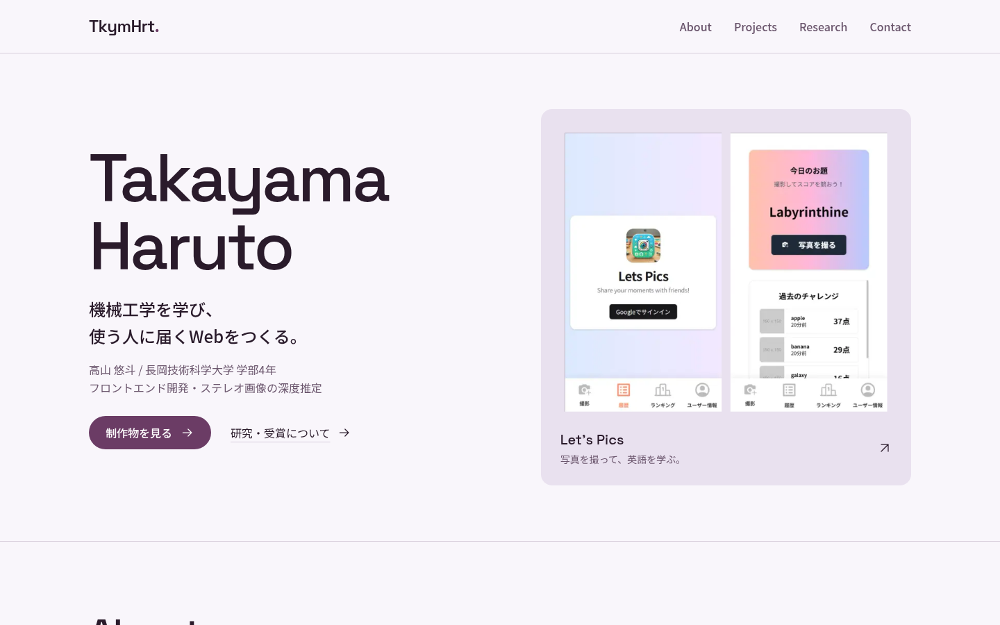

# TkymHrt Portfolio

Next.js / React / TypeScript で構築したポートフォリオサイトです。

- [Vercel](https://tkymhrt-portfolio.vercel.app/)
- [Netlify](https://tkymhrt-portfolio.netlify.app/)



## 開発環境

[mise](https://mise.jdx.dev/getting-started.html) をインストールしてください。Node.js `24.21.0`、Bun `1.4.2` は `mise.toml` に固定しています。CI は mise `2026.10.0` を使用します。パッケージ管理は Bun に統一し、`bun.lock` をコミットします。

```sh
mise trust
mise install
mise run install
mise run hooks
mise run dev
```

開発サーバーは [http://localhost:3000](http://localhost:3000) で開きます。

## 開発コマンド

| コマンド                | 内容                                            |
| ----------------------- | ----------------------------------------------- |
| `mise run dev`          | 開発サーバーを起動                              |
| `mise run build`        | 本番用にビルド                                  |
| `mise run start`        | ビルド済みの本番サーバーを起動                  |
| `mise run lint`         | Oxlint による lint                              |
| `mise run lint:fix`     | Oxlint の安全な修正を適用                       |
| `mise run format`       | Oxfmt によるフォーマット                        |
| `mise run format:check` | フォーマットの確認                              |
| `mise run typecheck`    | Next.js の型生成と TypeScript の型確認          |
| `mise run knip`         | 未使用の依存関係・ファイル・export を検出       |
| `mise run doctor`       | React Doctor による実装の確認                   |
| `mise run audit`        | 依存関係の脆弱性を確認                          |
| `mise run check`        | lint・format・型・Knip・React Doctor を順に確認 |
| `mise run ci`           | CI と同じ品質確認と本番ビルド                   |
| `mise run hooks`        | Lefthook の Git hooks をインストール            |

Lefthook は commit 前に lint と format の確認、push 前に型・Knip・React Doctor の確認を実行します。チェック対象はプロジェクト全体です。フォーマットが必要な場合は `mise run format` を実行して変更を確認し、ステージしてください。

React Doctor はプロジェクト全体のコードを診断し、warning 以上を失敗として扱います。テレメトリとリモートの supply-chain 検査は無効にしています。依存関係の脆弱性は `mise run audit` で別途確認します。

## CI と依存関係の更新

GitHub Actions は `main` / `develop` への push と pull request で `mise run check` と `mise run build` を実行します。依存関係は `bun install --frozen-lockfile` でインストールし、CI でファイルを変更・commit しません。Actions はコミット SHA に固定し、Dependabot が Bun の依存関係と Actions を毎週確認します。

パッケージ更新時は `bun.lock` も更新して `mise run ci` を実行してください。Node.js / Bun の更新時は `mise.toml`、`package.json` の `engines` / `packageManager` を揃えて変更します。mise 自体の更新時は両方の workflow の固定バージョンと `mise.toml` の `min_version` を揃えます。

Lighthouse CI の間接依存 `@puppeteer/browsers`、`basic-ftp`、`chrome-launcher`、`tmp`、`uuid` は、脆弱性のある依存を除去するため `overrides` で固定しています。固定した Node.js での Lighthouse 実行と互換性を確認済みです。上流の更新で不要になったら削除してください。

PostCSS / Tailwind CSS / React Doctor の間接依存 `source-map-js` は、[ソースマップの処理によるサービス拒否の脆弱性](https://github.com/advisories/GHSA-68fv-2mgg-jv7q)を修正した `1.2.2` に `overrides` で固定しています。

2026-10-13 時点で `mise run audit` の指摘は中程度の 1 件です。Lighthouse CI → `js-yaml` → `argparse` の間接依存 `sprintf-js` に[書式文字列の精度指定によるサービス拒否の脆弱性](https://github.com/advisories/GHSA-hp3w-g68c-fv3c)が報告されていますが、修正版は未公開です。監査結果を抑制せず、上流の修正を待っています。

Lighthouse はインストール済みの Chrome を使用します。

## Impeccable

デザインの改善に使う [Impeccable skill](.agents/skills/impeccable/SKILL.md) をプロジェクト内に同梱しています。skill `4.5.0` / engine `0.1.11`、upstream commit `508d7e8955de3b3caf2d8676e85206723d41a887` に固定しています。[取得元・ライセンス・更新手順](.agents/skills/impeccable/UPSTREAM.md)も記録しています。

Codex では `$impeccable polish` や `$impeccable audit` を使用できます。手動で検出を実行する場合は、プロジェクトルートで以下を実行してください。

```sh
.agents/skills/impeccable/scripts/impeccable detect app/ components/
# 開発サーバーを起動した状態で、表示結果を確認する場合
.agents/skills/impeccable/scripts/impeccable detect http://localhost:3000
```

初回実行時に固定バージョンの engine をダウンロードし、SHA-256 を確認します。プロジェクト内の skill として使用し、自動 Codex hooks は設定していません。

## Lighthouse CI

`main` / `develop` への push と同ブランチからの手動実行で、本番ビルドを起動して Lighthouse を実行します。レポートは `lighthouserc.js` で指定した既存のセルフホストサーバーへ送信します。GitHub の repository secret `LHCI_TOKEN` を設定してください。未設定の場合は Lighthouse の workflow をスキップします。

ローカルで実行する場合は `LHCI_TOKEN` を環境変数に設定して `mise run lhci` を実行してください。収集だけを確認する場合は `mise run build` の後に `mise exec -- ./node_modules/.bin/lhci collect` を実行できます。

Chrome を自動検出できない場合は、実行時に `CHROME_PATH` で指定してください（例: `CHROME_PATH=/usr/bin/chromium mise run lhci`）。

`/admin` はブラウザ内だけで状態を保持するデモです。データの永続化や認証は実装していません。
